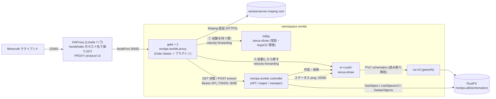

# moripa-worlds

MoripaUtils (`/mu schematic upload`) が S3 互換ストレージ (RustFS) にアップロードした schematic を、
Minecraft で `<uuidv7>.world.site1.dev.morino.party` に接続するだけで遊べるワールドとして起動します。

- 接続先のホスト名に含まれる schematic ID (UUID v7) から `schematics/<ID>/info.json` を探し、
  [ianua-silvae](https://github.com/morinoparty/ianua-silvae) (Minestom 製の軽量サーバー) のワールドを Kubernetes 上に作ります。
- プレイヤーは Mojang の認証を済ませると、ワールドが起動済みならそのまま、まだなら常設の**ロビー**に入り、
  アクションバーに「「<タイトル>」を起動しています… N秒」と出ている間にワールドが起動して、**再接続なしで**ワールドへ移ります。
- ワールドを作るのは認証済みのプレイヤーが来たときだけです。サーバーリストの ping では作らず、MOTD で状態を表示します。
- 誰もいなくなったワールド・起動しないワールド・schematic が消えたワールドは自動で片付けます。
- `info.json` の `delete_at` を過ぎた schematic は S3 から削除します (MoripaUtils 自身は削除しないため)。

1 つのイメージ `ghcr.io/morinoparty/moripa-worlds` に 2 つのサブコマンドがあります。

| サブコマンド | Deployment | 役割 | 権限 |
| --- | --- | --- | --- |
| `moripa-worlds proxy` | `gate` (2 台) | [Gate](https://github.com/minekube/gate) v0.74.32 を classic モードで組み込んだプロキシ + プラグイン。ロビーで待たせ、起動したワールドへ移す | なし (Kubernetes の権限・S3 のキーを持たない。コントローラーの API だけを使う) |
| `moripa-worlds controller` | `moripa-worlds` (1 台) | ワールドの作成 API・reaper・sweeper | namespace `worlds` の Role と S3 のキー |

`moripa-worlds --version` でバージョンを表示します。設定はすべて環境変数で渡します (引数はサブコマンド名だけ)。

## 構成



接続の流れ:

1. ハブの HAProxy が `<uuid>.world.site1.dev.morino.party` 宛ての接続を PROXY protocol v2 付きで NodePort 30565 (Service `gate`) へ送ります。
2. **認証の前** (`PreLoginEvent`): ホスト名が `<uuid><WORLD_HOST_SUFFIX>` でなければ「このアドレスでは接続できません」、
   プロトコル番号が `REQUIRED_PROTOCOL` (777 = Minecraft 26.3) でなければ「Minecraft 26.3 で接続してください」で切断します (Mojang に問い合わせません)。
3. Gate が Mojang の認証を行います (`onlineMode: true`)。
4. **認証の後** (`PlayerChooseInitialServerEvent`): API で状態を聞き (`GET /v1/worlds/{id}`)、
   - 見つからない → 「ワールドが見つかりません: <id>」で切断。
   - `ready` → `w-<uuid>` を Gate に登録し、最初の接続先にする (ロビーを経由しない)。
   - それ以外 → `POST /v1/worlds/{id}/ensure` (3 秒で打ち切り)。`full` / `rate_limited` → 「現在混み合っています…」、`error` → 「ワールドを起動できませんでした…」で切断。
     `created` / `existing` → 最初の接続先をロビーにして、待機ループを始める。
5. **待機ループ** (プレイヤーごと、`player.Context()` に紐づく): 1 秒ごと (揺らぎ付き) に状態を見て、2 秒ごとにアクションバーを送ります。
   状態の問い合わせはワールドごとに 1 本にまとめる (singleflight + 0.9 秒のキャッシュ) ので、N 人が同じワールドを待っても API へは 1 秒に 1 回程度です。
   - `ready` かつロビーに入り終えている → `w-<uuid>` を登録して `CreateConnectionRequest(...).ConnectWithIndication(ctx)` (15 秒の期限付き)。
     失敗したら少し置いて再試行し、3 回失敗したら「ワールドに接続できませんでした…」で切断。
   - `absent` (起動中に reaper に消された等) → 5 秒以上空けて ensure し直す。
   - 見つからなくなった → 切断。API のエラーは間隔を空けて待ち続ける。
   - `STARTUP_WAIT` (既定 5 分、コントローラーの `STARTUP_TIMEOUT` に揃える) を過ぎたら「起動に時間が掛かりすぎています…」で切断。
   - プレイヤーが切断するとループは終わります (ゴルーチンを残しません)。
6. **ワールドから落とされたとき** (`KickedFromServerEvent`、クラッシュ・再起動など): 理由が BAN・ホワイトリスト・管理者のキック・二重ログインに見えなければ、
   ロビーへ戻して「ワールドとの接続が切れました。再起動を待っています…」と表示し、待機ループをやり直します (5 秒置いてから接続。1 プレイヤーにつき 3 回まで)。
   ロビーから移る途中の失敗は、Gate の英語の既定文言を「ワールドへの接続に失敗しました。再試行しています…」に差し替え、待機ループが数えて再試行します。
   ロビーから落とされたときは Gate の既定どおり切断します。
7. ロビーとワールドは Velocity modern forwarding (共通の秘密 `worlds-forwarding`) だけを受け付けるので、Gate を経由しない接続は入れません。

ロビー (`lobby`) は ArgoCD が管理する常設の ianua-silvae で、コントローラーは触りません
(`app.kubernetes.io/managed-by=moripa-worlds` を付けると reaper に消されるので付けないこと)。

### サーバーリスト (ping)

ping ではワールドを作りません (認証なしで送れるため、作ると `MAX_WORLDS` の枠を埋め続けられる)。
状態は ID ごとに 5 秒キャッシュし、同時の問い合わせは 1 回にまとめます。バージョンは常に `26.3` (protocol 777) と答えます。

| 状況 | MOTD |
| --- | --- |
| 起動済み | `<title>` + 改行 + `§7プレイ可能` |
| 起動中 | `<title>` + 改行 + `§e起動中…` |
| 停止中 | `<title>` + 改行 + `§7参加すると起動します` |
| 見つからない | `§cワールドが見つかりません` |
| ワールドのホスト名でない | `§cこのアドレスでは接続できません` |
| API のエラー | `§c状態を確認できません` |

タイトルからは `§` と改行を取り除き 48 文字で切ります (アップロードした人が色や 2 行目を乗っ取れないように)。
人数はこの Gate 上でそのワールドにいる人数 / 20 です。アイコンは Gate の設定の `status.favicon` (Gate の既定のアイコンなら出さない)。

## コントローラーの API

`LISTEN_HTTP` (`:8080`) で `/healthz` `/readyz` `/metrics` と同じポートに出します。`/v1/` 以下は `Authorization: Bearer <API_TOKEN>` が必要で、
トークンは SHA-256 にしてから定数時間で比較します (違えば `401` と `WWW-Authenticate`)。`{id}` は小文字の正規形 UUID v7 だけ (それ以外は `400`)。

```http
GET  /v1/worlds/{id}
POST /v1/worlds/{id}/ensure
```

```json
{"id":"0199c8a0-7b3e-7f12-9a4c-1d2e3f405162","found":true,"title":"ロビーの噴水","state":"starting",
 "address":"w-0199c8a0-7b3e-7f12-9a4c-1d2e3f405162.worlds.svc.cluster.local:25565","result":"created"}
```

| フィールド | 意味 |
| --- | --- |
| `found` | `info.json` があり、不正でなく、`delete_at` を過ぎていない。`false` なら `title` は `null`、`state` は `absent` |
| `title` | info.json の `title` (未設定なら `null`) |
| `state` | `absent` (Deployment が無い) / `starting` (Deployment はあるが ready でない。削除中も含む) / `ready` (Deployment の Pod が Ready、かつワールドがステータス ping に応答する。成功は 2 秒覚える) |
| `address` | Gate が接続するアドレス |
| `result` | ensure のときだけ: `created` / `existing` / `full` (`MAX_WORLDS`) / `rate_limited` (作成 10 回/分) / `not_found` / `error` |

GET は S3 のエラーのとき `503`。POST は S3 / Kubernetes のエラーでも `200` で `result: "error"` を返します。`created` の直後は informer にまだ見えないので `state: "starting"` を返します。
`MAX_WORLDS` とレート制限はコントローラーだけが持ちます (プロキシは結果を表示するだけ)。

### 作られるオブジェクト

すべて namespace `worlds`、名前 `w-<uuid>`、ラベル
`app.kubernetes.io/name=ianua-silvae` / `app.kubernetes.io/component=world` / `app.kubernetes.io/managed-by=moripa-worlds` / `worlds.morino.party/id=<uuid>` 付き
(ArgoCD に追跡されないよう `app.kubernetes.io/instance` は付けません)。
ConfigMap と Service には Deployment の ownerReference を付けるので、Deployment を消せば GC でも消えます。

- **ConfigMap** (`config.json`、immutable): ianua-silvae の設定。
  - `schematicPath`: `/schematics/<uuid>/<file_name>` (`file_name` は info.json の値。決め打ちしない)
  - `schematicOrigin`: `(0, WORLD_ORIGIN_Y, 0)`
  - `spawn`: `schematicOrigin + spawn_position` (x / y / z を足し、yaw / pitch はそのまま)
  - `voidDepth`: `32`。奈落 (スポーンへ戻す高さ) は ianua-silvae が schematic を読んだ後に `min(一番下のブロック, spawn.y) - 32` とします。
    schematic のブロックは `schematicOrigin + Offset + (x, y, z)` に置かれ、Offset は info.json に無いのでコントローラーでは決められません。
  - `voidY`: `min(WORLD_ORIGIN_Y + min(spawn_position.y, 0) - world_size.height, -64) - 32` (`voidDepth` を知らない古い ianua-silvae 向けの保険。ブロックが置かれうる最低の y=-64 より下)
  - `motd`: `{"description": title (なければ "morino.party world"), "maxPlayers": 20}`、`onlineMode: true`、`velocitySecret: null`
    (秘密は ConfigMap に書かず、下の環境変数で渡す)
- **Deployment** (replicas 1、Recreate): `WORLD_IMAGE` を UID/GID 10001・readOnlyRootFilesystem・capabilities なし・seccomp RuntimeDefault で動かします。
  PVC `WORLD_SCHEMATICS_PVC` を `/schematics` に読み取り専用で、ConfigMap を `/server/config` に、emptyDir を `/tmp` にマウントします。
  initContainer (`busybox:1.37`) が schematic 本体が見えるまで最大 120 秒待ちます (geesefs は一覧を ~10 秒キャッシュするため)。
  環境変数 `IANUA_VELOCITY_SECRET` を Secret `FORWARDING_SECRET_NAME` (既定 `worlds-forwarding`) のキー `secret` から渡します。
  これがあると ianua-silvae は Velocity modern forwarding の接続だけを受け付け、自分では認証しません (`IANUA_ONLINE_MODE` は無視されます)。
  Secret が無いと Pod は `CreateContainerConfigError` で起動しません (認証なしで開くよりよいため)。
  ServiceAccount トークンと Service リンクの環境変数は渡しません。`worlds.morino.party/last-active` アノテーションに最後にプレイヤーがいた時刻を、
  `worlds.morino.party/played=true` アノテーションに一度でもプレイヤーがいたことを記録します。
- **Service** (ClusterIP、`25565/TCP` 名前 `minecraft`)。

### ワールドの片付け (reaper)

30 秒ごとに管理対象の Deployment を調べ、次の場合に Deployment / Service / ConfigMap を削除します。

| reason | 条件 |
| --- | --- |
| `startup_timeout` | 作成 (または Available=False になって) から `STARTUP_TIMEOUT` 経っても Ready にならない |
| `idle` | Ready なワールドにステータス ping (`w-<uuid>.<ns>.svc:25565`) して `players.online` が 0 のまま `IDLE_TIMEOUT` 経った。最後にプレイヤーがいた時刻はアノテーションに残すので、コントローラーが再起動しても引き継ぎます |
| `unjoined` | Ready になってから一度もプレイヤーがいないまま `UNJOINED_TIMEOUT` 経った (`played` アノテーションがない)。参加されないワールドが枠を長く占めないようにするため |
| `schematic_missing` | info.json が消えた |
| `expired` | `delete_at` を過ぎた |

S3 に一時的に繋がらない場合は削除しません。
Ready かどうかに関わらず、info.json が有効なワールドの ConfigMap / Service が欠けていたり、前の世代のもの
(ownerReference の UID が今の Deployment と違う) だったりすれば作り直します。
作成 (API の ensure) と削除 (reaper / sweeper) は同じロックで直列化し、作成時に同名の消し残しがあれば UID を確かめて作り直します。

### 期限切れ schematic の削除 (sweeper)

`DELETE_EXPIRED=true` のとき、起動直後と `SWEEP_INTERVAL` ごとに `S3_PREFIX` 直下を ListObjectsV2 (delimiter `/`) で列挙し、
各 `<id>/info.json` を読んで `delete_at` を過ぎたものについて、

1. そのワールドの Kubernetes オブジェクトを削除し、
2. `<id>/` 以下を先に列挙し (列挙に失敗したら何も消しません)、「info.json があれば本体もある」という前提を崩さないよう
   `info.json` を先に、残りのオブジェクトをその後に DeleteObjects (1000 件ずつ) で削除します。

`info.json` を消した後で失敗すると info.json のないディレクトリが残ります。これは取りこぼさないよう、

- 同じプロセス内では失敗した ID を覚えておき、次の走査で残りを消します。
- info.json のないディレクトリは、中のオブジェクトの最終更新 (LastModified の最大) から 24 時間経っていれば消します
  (再起動を挟んだ場合や、本体だけ書かれて info.json が書かれなかったアップロードの残骸もこれで消えます)。
  アップロード途中 (本体を書いてから info.json を書くまでの数秒) のディレクトリには触りません。

info.json があるが内容が不正なディレクトリ (期限が分からない) と UUID v7 でないディレクトリには触りません。削除したキーはログに出します。
走査全体は 10 分、S3 の呼び出しは 1 回ごとに 5 秒 (DeleteObjects は 30 秒) で打ち切るので、RustFS への接続が止まっても sweeper が止まり続けることはありません。

## 環境変数

### controller

| 変数 | 既定値 | 説明 |
| --- | --- | --- |
| `NAMESPACE` | (必須) | ワールドを作る namespace。Downward API で渡す |
| `API_TOKEN` | (必須、16 文字以上) | プロキシが API を呼ぶときの Bearer トークン。Secret `moripa-worlds-api` の `token` から渡す |
| `WORLD_HOST_SUFFIX` | `.world.site1.dev.morino.party` | (ログ用) |
| `LISTEN_HTTP` | `:8080` | API と `/healthz` `/readyz` `/metrics` |
| `S3_ENDPOINT` | `http://rustfs-svc.rustfs.svc.cluster.local:9000` | S3 エンドポイント (常に path-style) |
| `S3_REGION` | `us-east-1` | |
| `S3_BUCKET` | `moripa-utils` | |
| `S3_PREFIX` | `schematics/` | |
| `AWS_ACCESS_KEY_ID` / `AWS_SECRET_ACCESS_KEY` | (必須) | Secret `moripa-worlds-s3` から渡す |
| `WORLD_IMAGE` | (必須) | 例: `ghcr.io/morinoparty/ianua-silvae:main@sha256:…` |
| `WORLD_SCHEMATICS_PVC` | `schematics` | `moripa-utils/schematics` を読み取り専用でマウントする PVC |
| `WORLD_ORIGIN_Y` | `64` | schematic を貼り付ける Y |
| `WORLD_CPU_REQUEST` | `200m` | ワールドの CPU の request (limit は付けない) |
| `WORLD_MEMORY_REQUEST` / `WORLD_MEMORY_LIMIT` | `384Mi` / `768Mi` | ワールドのメモリ |
| `FORWARDING_SECRET_NAME` | `worlds-forwarding` | ワールドの Pod に `IANUA_VELOCITY_SECRET` として渡す Secret (キー `secret`) |
| `MAX_WORLDS` | `6` | 同時に存在できるワールドの数 (既存の `w-*` Deployment を数える) |
| `IDLE_TIMEOUT` | `10m` | 0 人のまま経ったら削除するまでの時間 |
| `UNJOINED_TIMEOUT` | `3m` | 一度もプレイヤーが入らないまま (Ready から) 経ったら削除するまでの時間。`IDLE_TIMEOUT` 以上なら `IDLE_TIMEOUT` と同じ扱い |
| `STARTUP_TIMEOUT` | `5m` | Ready にならなかったら削除するまでの時間 |
| `SWEEP_INTERVAL` | `1h` | sweeper の間隔 |
| `DELETE_EXPIRED` | `true` | sweeper を動かすか |
| `LOG_LEVEL` | `info` | `debug` / `info` / `warn` / `error` (ログは JSON) |

固定のパラメーター: reaper の間隔 30 秒、作成のレート制限 10 回/分 (バースト 10)、ステータス ping の期限 3 秒。
ロビーにいるプレイヤーはワールドのステータス ping の人数に入らないので、待っている間に idle / unjoined と判定されることはありません
(起動中は Ready でないので reaper はまだ人数を見ません)。

### proxy

| 変数 | 既定値 | 説明 |
| --- | --- | --- |
| `API_TOKEN` | (必須、16 文字以上) | controller と同じトークン |
| `FORWARDING_SECRET` | (必須、16 文字以上) | Velocity modern forwarding の秘密。Secret `worlds-forwarding` の `secret` から渡す。**Gate の設定ファイルには書かない** |
| `API_URL` | `http://moripa-worlds.worlds.svc.cluster.local:8080` | controller の API |
| `GATE_CONFIG` | `/etc/gate/config.yml` | Gate の設定ファイル (ConfigMap) |
| `WORLD_HOST_SUFFIX` | `.world.site1.dev.morino.party` | ホスト名から ID を取り出すときのサフィックス (先頭の `.` 込み) |
| `LOBBY_SERVER` | `lobby` | ロビーのサーバー名 (Gate の設定の `servers` のキー) |
| `REQUIRED_PROTOCOL` / `REQUIRED_VERSION_NAME` | `777` / `26.3` | 受け付ける唯一のクライアントのバージョン (ianua-silvae に合わせる) |
| `STARTUP_WAIT` | `5m` | ロビーで待つ上限。controller の `STARTUP_TIMEOUT` に揃える |
| `LISTEN_HTTP` | `:8080` | `/healthz` `/readyz` (常に 200) `/metrics` |
| `LOG_LEVEL` | `info` | Gate のログもこの JSON ログに出ます |

固定のパラメーター: 状態の確認 1 秒ごと、アクションバー 2 秒ごと、ワールドへの接続 15 秒 × 3 回、API の呼び出し 3 秒、ping の状態キャッシュ 5 秒、
ワールドから落とされたときのロビーへの戻し 3 回まで、誰もいないワールドのサーバー登録は 10 分ごとに外す。

## Gate の設定 (proxy)

`GATE_CONFIG` のファイルを Gate の `LoadConfig` で読み、`FORWARDING_SECRET` を `forwarding.velocitySecret` に差し込んでから起動します。
次を満たさない設定では起動しません: `lite.enabled: false`、`forwarding.mode: velocity`、ファイルに `velocitySecret` を書かない、
`servers` に `LOBBY_SERVER` がある、`try` と `forcedHosts` が空、`via.enabled: false`、`api` と `connect` が無効、
`connectionTimeout` / `readTimeout` をナノ秒で書く (下の注意を参照)。
組み込みコマンド (`/server` など) と BungeeCord の plugin message はプラグインが無効にします (他のワールドやロビーへ自分で移れないように)。

```yaml
config:
  bind: 0.0.0.0:25565
  onlineMode: true
  # HAProxy から PROXY protocol v2 で受ける。信頼する送信元は既定 (ループバック・プライベート・リンクローカル) のまま
  proxyProtocol: true
  forwarding:
    mode: velocity        # 秘密は環境変数 FORWARDING_SECRET から
  servers:
    lobby: lobby.worlds.svc.cluster.local:25565
  try: []                 # 振り分けはプラグインが行う
  lite:
    enabled: false
  # ナノ秒で書く (Gate が使う所で time.Millisecond 倍して 5 秒 / 30 秒になる。下の注意を参照)
  connectionTimeout: 5000ns
  readTimeout: 30000ns
  status:
    showMaxPlayers: 20
```

`config.quota` (接続 5 回/秒・ログイン 0.4 回/秒、IP ごと) は既定で有効で、PROXY protocol で渡された実際のクライアント IP に掛かります。

> [!WARNING]
> **Gate v0.74.32 の classic モードは `connectionTimeout` / `readTimeout` を二重に `time.Millisecond` 倍します。**
> `configutil.Duration` は既にナノ秒の `time.Duration` なのに、使う所で `time.Duration(cfg.ConnectionTimeout)*time.Millisecond` のように
> もう一度 `time.Millisecond` を掛けています (`pkg/edition/java/proxy/proxy.go` の `withConnectionTimeout` (Mojang の認証にも使う) と
> クライアント接続の読み書きの期限、`server.go` のバックエンド接続の読み書きの期限、`switch.go` のキック後のリダイレクト)。
> さらに `LoadConfig` は既定値を JSON 経由で読み直す際にナノ秒の数値をミリ秒として読むので、既定の `5s` / `30s` は約 1388 時間 / 8333 時間になり、
> 使う所で掛け算が int64 を桁あふれして約 10791 日 / 64747 日 (実質無期限) になります。
> 放っておくと、パケットを捨てる (応答しない) バックエンドへの接続でプレイヤーが止まったままになり、handshake だけ送って黙るクライアントは
> HAProxy の `timeout client` (1 時間) まで残ります。
>
> そこで設定には **ナノ秒で** `connectionTimeout: 5000ns` / `readTimeout: 30000ns` と書きます (Gate が使う所で 1000 倍されて 5 秒 / 30 秒)。
> proxy は Gate が掛けた後の実効値が 1 秒〜10 分に収まらない設定 (省略して既定のまま・`5s` や `5000` と書いた等) では起動しません。
> 副作用が 2 つあり、proxy が対処しています:
>
> - BungeeCord の plugin message の `Connect` (`bungee.go`) は値を倍さずに使い 5µs で必ず失敗するので、`bungeePluginChannelEnabled` を
>   proxy が無効にします (ワールドもロビーも使わない。組み込みコマンドと同じく、勝手にサーバーを移れないようにする意味もあります)。
> - `reportSilentBackendAfterReadTimeout` (ログだけ) も値を倍さずに使い、30µs で「backend server has not sent a single packet since the
>   connection was established」をバックエンドへのログインごとに 1 回 Error で出すので、proxy がこのメッセージだけ Gate のログから落とします。
>
> プラグインがワールドへ移す接続には、これとは別に自分の期限 (15 秒) を掛けています。

### ビルドタグ `musl`

Gate の ViaLite (`go.minekube.com/vialite`) は purego 経由で `libdl` を動的リンクさせるため、`CGO_ENABLED=0` でも
distroless/static では起動できません。Gate 自身の musl ビルドと同じ `-tags musl` で ViaLite と OpenTelemetry を外して静的バイナリにしています
(`Dockerfile`・`make build`。動的リンクに戻ると `docker build` が失敗します)。`go test` / `go vet` はタグなしでも通ります。

## 必要な権限・Secret

- controller: ServiceAccount `moripa-worlds` に namespace `worlds` の Role:
  `deployments` (apps) / `services` / `configmaps` に `get, list, watch, create, update, patch, delete`、`pods` に `get, list, watch`。
  S3 のキー: `moripa-utils/schematics/*` に `s3:GetObject` / `s3:DeleteObject`、バケット `moripa-utils` に `s3:ListBucket` / `s3:GetBucketLocation`。
- proxy: 権限なし (`automountServiceAccountToken: false`)。S3 のキーも渡さない。
- Secret `worlds-forwarding` (`secret`: 32 文字以上のランダム): proxy の `FORWARDING_SECRET`、ロビーとワールドの `IANUA_VELOCITY_SECRET`。
- Secret `moripa-worlds-api` (`token`: 40 文字程度のランダム): proxy と controller の `API_TOKEN`。

Deployment はそれぞれ `args: [proxy]` / `args: [controller]` で起動します (引数なしでは使い方を表示して終了します)。
proxy は `25565` (Minecraft) と `8080` (メトリクス)、controller は `8080` (API・メトリクス) だけを使います (controller の `25565` は廃止)。

## メトリクス

controller (`:8080/metrics`):

| 名前 | 種類 | ラベル |
| --- | --- | --- |
| `worlds_running` | gauge | 現在のワールド (管理対象 Deployment) の数 |
| `api_requests_total` | counter | `op` (`state` / `ensure`)、`result` (`absent` / `starting` / `ready` / `not_found` / `created` / `existing` / `full` / `rate_limited` / `error` / `bad_request` / `unauthorized`) |
| `worlds_created_total` | counter | |
| `worlds_reaped_total` | counter | `reason` (`idle` / `unjoined` / `startup_timeout` / `schematic_missing` / `expired` / `swept`) |
| `schematics_swept_total` | counter | |

`/readyz` は Deployment の informer が同期済みで、S3 に ListObjectsV2 できるときだけ 200 を返します。

proxy (`:8080/metrics`):

| 名前 | 種類 | ラベル |
| --- | --- | --- |
| `players_waiting` | gauge | ロビーでワールドの起動を待っている人数 |
| `world_connects_total` | counter | `result` (`success` / `failed` (再試行する) / `gave_up` / `timeout` / `not_found` / `busy` / `error`) |
| `logins_total` | counter | `result` (`world` / `lobby` / `disconnect` / `denied_host` / `denied_version`) |

## セキュリティ

- 認証は Gate (Mojang) だけが行い、ロビーとワールドは Velocity modern forwarding の HMAC を確かめて Gate 経由の接続だけを受け付けます。
  秘密は Secret から環境変数で渡し、ConfigMap (Gate の設定・ワールドの config.json) には書きません。
- ワールドを作るのは認証済みのプレイヤーのログインだけです (ping・認証前の段階では作らない)。
  ホスト名とバージョンは認証の前に確かめるので、関係のない接続で Mojang に問い合わせることもありません。
  作成は全体で 10 回/分、`MAX_WORLDS` で上限を掛け、参加されないワールドは `UNJOINED_TIMEOUT` で早めに片付けます。
- proxy は Kubernetes の権限も S3 のキーも持たず、controller の API (トークン必須、定数時間比較) だけを使います。
  インターネットに面する proxy が乗っ取られても、ワールドの作成 (上限・レート制限付き) 以上のことはできません。
- API の `{id}` とホスト名の ID は正規形の UUID v7 だけを受け付けるので、Kubernetes の名前・S3 のキー・パスに任意の文字列が入ることはありません。
  info.json の `file_name` も `[A-Za-z0-9._-]` (先頭 `.` 不可、128 文字まで) だけを受け付け、initContainer にはシェルに埋め込まず環境変数で渡します。
- NetworkPolicy の想定: proxy の egress は DNS・controller の `8080`・ロビー / ワールドの `25565`・インターネットの `443` (Mojang)。
  ロビー / ワールドの ingress は proxy と controller (ステータス ping) からの `25565` だけ。controller の ingress は proxy と監視系からの `8080` だけ。
- ワールド・ロビー・proxy・controller の Pod は Pod Security Standards の restricted を満たす設定です。コンテナイメージは distroless (static、nonroot) です。

## 開発

Go はローカルに入れず、docker の `golang:1.26` で動かします。

```sh
make test              # go test -race ./...
make vet lint          # go vet / golangci-lint (docker)
make test-integration  # rustfs/rustfs:1.0.1 を起動して S3 まわりの統合テスト (build tag integration)
make build image       # bin/moripa-worlds / コンテナイメージ
```

本番と同じ権限のキーで統合テストを流す方法は `internal/schematic/integration_test.go` の先頭を参照してください。

### 結合確認 (docker だけ)

```sh
sh hack/e2e/run.sh          # KEEP=1 で終わってもコンテナを残す
```

docker ネットワーク `mwe2e` に次を置き、`hack/e2e/mcclient.py` (標準ライブラリだけの最小クライアント、`python3 -I` で動く) で確かめます。

- `devcontroller` (`hack/devcontroller`): 本物の API ハンドラーをメモリ上のワールドで動かす。ensure から `-ready-after` (15 秒) 経ち、`world:25565` が ping に応答したら `ready`。
- `gate`: このリポジトリのイメージの `proxy` (`hack/e2e/config.yml`。`onlineMode: false`・`proxyProtocol: false`・quota なし)。
- `lobby` / `world`: `ghcr.io/morinoparty/ianua-silvae` (26.3) に `IANUA_VELOCITY_SECRET` と小さな schematic を渡したもの。

確かめること: 停止中 / 見つからない / ワールドでないホストの MOTD、26.2 (776) とワールドでないホストと存在しないワールドのログインが断られること、
ログイン → ロビー (CONFIG → PLAY) → 起動中の MOTD → アクションバー → Start Configuration で world へ移る (2 回目の Join Game) → 起動後の MOTD。
`docker restart mwe2e-world` でワールドを落とすと、ロビーへ戻って「ワールドとの接続が切れました…」が出て、起動後にワールドへ戻ります。

## ライセンス

[CC0 1.0 Universal](LICENSE)
