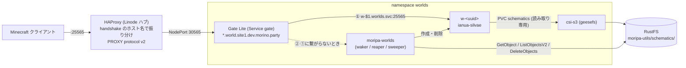

# moripa-worlds

MoripaUtils (`/mu schematic upload`) が S3 互換ストレージ (RustFS) にアップロードした schematic を、
Minecraft で `<uuidv7>.world.site1.dev.morino.party` に接続するだけで遊べるワールドとして起動するコントローラーです。

- 接続先のホスト名に含まれる schematic ID (UUID v7) から `schematics/<ID>/info.json` を探し、
  [ianua-silvae](https://github.com/morinoparty/ianua-silvae) (Minestom 製の軽量サーバー) のワールドを Kubernetes 上に作ります。
- サーバーリストの ping でもワールドが起動します。起動中は MOTD で「起動しています…」と表示し、ログインには再接続を促します。
- 誰もいなくなったワールド・起動しないワールド・schematic が消えたワールドは自動で片付けます。
- `info.json` の `delete_at` を過ぎた schematic は S3 から削除します (MoripaUtils 自身は削除しないため)。

## 構成



1. Gate Lite はホスト名の `*` を `$1` として取り出し、`w-$1.worlds.svc.cluster.local:25565` → `moripa-worlds.worlds.svc.cluster.local:25565` の順に接続を試みます (`strategy: sequential`)。
2. ワールドが動いていなければ Service がない (NXDOMAIN) か、エンドポイントがなく Cilium が reject するので、接続は moripa-worlds (waker) に落ちます。
3. waker はワールドを作成し、MOTD / 切断メッセージを返します。10〜30 秒後に再接続すると、今度は ① でワールドに直接繋がります。

### ワールドの起動 (waker)

`LISTEN_MINECRAFT` で Gate から転送された接続を受けます (PROXY protocol なし)。

1. Handshake を読みます (1 KiB まで・5 秒以内)。サーバーアドレスは Gate と同じ規則で正規化します (Forge の `\0FML…` 以降と `///` 以降を除き、前後の `.` を削って小文字化)。
2. `<id><WORLD_HOST_SUFFIX>` の `<id>` が小文字の正規形 UUID (version 7・variant 10) でなければ「見つかりません」。
3. `S3_PREFIX<id>/info.json` を GetObject で読みます (見つかった結果は 30 秒、見つからなかった結果は 10 秒キャッシュ。同じ ID への同時問い合わせは 1 回にまとめます)。
   ない・不正・`delete_at` を過ぎている場合は「見つかりません」。
4. ワールドがなければ作ります。`MAX_WORLDS` に達している、または作成のレート制限 (全体で 10 回/分) に掛かった場合は「混み合っています」。

| 状況 | サーバーリスト (MOTD) | ログイン (切断メッセージ) |
| --- | --- | --- |
| 起動した / 起動中 | `<title> を起動しています…` (version 名 `starting`、プロトコル番号はクライアントのものを返すので互換ありと表示) | `ワールドを起動しています。10〜30秒後に再接続してください` |
| 見つからない | `ワールドが見つかりません` (赤) | `ワールドが見つかりません: <id>` (赤) |
| 上限・レート制限 | `現在混み合っています。しばらくしてから再接続してください` | 同左 |
| S3 / Kubernetes のエラー | `ワールドを起動できませんでした。しばらくしてから再接続してください` (赤) | 同左 |

人数は `0/20` を返します。Ping Request には Pong を返します (Gate Lite は Pong を自分で返すので、直接接続したときだけ使われます)。
next state 3 (transfer) はログインと同じ扱いです。

### 作られるオブジェクト

すべて namespace `worlds`、名前 `w-<uuid>`、ラベル
`app.kubernetes.io/name=ianua-silvae` / `app.kubernetes.io/component=world` / `app.kubernetes.io/managed-by=moripa-worlds` / `worlds.morino.party/id=<uuid>` 付き
(ArgoCD に追跡されないよう `app.kubernetes.io/instance` は付けません)。
ConfigMap と Service には Deployment の ownerReference を付けるので、Deployment を消せば GC でも消えます。

- **ConfigMap** (`config.json`、immutable): ianua-silvae の設定。
  - `schematicPath`: `/schematics/<uuid>/<file_name>` (`file_name` は info.json の値。決め打ちしない)
  - `schematicOrigin`: `(0, WORLD_ORIGIN_Y, 0)`
  - `spawn`: `schematicOrigin + spawn_position` (x / y / z を足し、yaw / pitch はそのまま)
  - `voidY`: `WORLD_ORIGIN_Y - world_size.height - 32`
  - `motd`: `{"description": title (なければ "morino.party world"), "maxPlayers": 20}`、`onlineMode: true`、`velocitySecret: null`
- **Deployment** (replicas 1、Recreate): `WORLD_IMAGE` を UID/GID 10001・readOnlyRootFilesystem・capabilities なし・seccomp RuntimeDefault で動かします。
  PVC `WORLD_SCHEMATICS_PVC` を `/schematics` に読み取り専用で、ConfigMap を `/server/config` に、emptyDir を `/tmp` にマウントします。
  initContainer (`busybox:1.37`) が schematic 本体が見えるまで最大 120 秒待ちます (geesefs は一覧を ~10 秒キャッシュするため)。
  ServiceAccount トークンと Service リンクの環境変数は渡しません。`worlds.morino.party/last-active` アノテーションに最後にプレイヤーがいた時刻を記録します。
- **Service** (ClusterIP、`25565/TCP` 名前 `minecraft`)。

### ワールドの片付け (reaper)

30 秒ごとに管理対象の Deployment を調べ、次の場合に Deployment / Service / ConfigMap を削除します。

| reason | 条件 |
| --- | --- |
| `startup_timeout` | 作成 (または Available=False になって) から `STARTUP_TIMEOUT` 経っても Ready にならない |
| `idle` | Ready なワールドにステータス ping (`w-<uuid>.<ns>.svc:25565`) して `players.online` が 0 のまま `IDLE_TIMEOUT` 経った。最後にプレイヤーがいた時刻はアノテーションに残すので、コントローラーが再起動しても引き継ぎます |
| `schematic_missing` | info.json が消えた |
| `expired` | `delete_at` を過ぎた |

S3 に一時的に繋がらない場合は削除しません。

### 期限切れ schematic の削除 (sweeper)

`DELETE_EXPIRED=true` のとき、起動直後と `SWEEP_INTERVAL` ごとに `S3_PREFIX` 直下を ListObjectsV2 (delimiter `/`) で列挙し、
各 `<id>/info.json` を読んで `delete_at` を過ぎたものについて、

1. そのワールドの Kubernetes オブジェクトを削除し、
2. 「info.json があれば本体もある」という前提を崩さないよう `info.json` を先に、残りのオブジェクトをその後に DeleteObjects (1000 件ずつ) で削除します。

info.json のないディレクトリ (アップロード途中など) や UUID v7 でないディレクトリには触りません。削除したキーはログに出します。

## 環境変数

| 変数 | 既定値 | 説明 |
| --- | --- | --- |
| `NAMESPACE` | (必須) | ワールドを作る namespace。Downward API で渡す |
| `WORLD_HOST_SUFFIX` | `.world.site1.dev.morino.party` | ホスト名から ID を取り出すときのサフィックス (先頭の `.` 込み) |
| `LISTEN_MINECRAFT` | `:25565` | waker の待ち受け |
| `LISTEN_HTTP` | `:8080` | `/healthz` `/readyz` `/metrics` |
| `S3_ENDPOINT` | `http://rustfs-svc.rustfs.svc.cluster.local:9000` | S3 エンドポイント (常に path-style) |
| `S3_REGION` | `us-east-1` | |
| `S3_BUCKET` | `moripa-utils` | |
| `S3_PREFIX` | `schematics/` | |
| `AWS_ACCESS_KEY_ID` / `AWS_SECRET_ACCESS_KEY` | (必須) | Secret `moripa-worlds-s3` から渡す |
| `WORLD_IMAGE` | (必須) | 例: `ghcr.io/morinoparty/ianua-silvae:main` |
| `WORLD_SCHEMATICS_PVC` | `schematics` | `moripa-utils/schematics` を読み取り専用でマウントする PVC |
| `WORLD_ORIGIN_Y` | `64` | schematic を貼り付ける Y |
| `WORLD_MEMORY_REQUEST` / `WORLD_MEMORY_LIMIT` | `384Mi` / `768Mi` | ワールドのメモリ |
| `MAX_WORLDS` | `6` | 同時に存在できるワールドの数 (既存の `w-*` Deployment を数える) |
| `IDLE_TIMEOUT` | `10m` | 0 人のまま経ったら削除するまでの時間 |
| `STARTUP_TIMEOUT` | `3m` | Ready にならなかったら削除するまでの時間 |
| `SWEEP_INTERVAL` | `1h` | sweeper の間隔 |
| `DELETE_EXPIRED` | `true` | sweeper を動かすか |
| `LOG_LEVEL` | `info` | `debug` / `info` / `warn` / `error` (ログは JSON) |

固定のパラメーター: reaper の間隔 30 秒、作成のレート制限 10 回/分 (バースト 10)、読み取りの期限 5 秒、同時接続数 256。

## 必要な権限

- ServiceAccount `moripa-worlds` に namespace `worlds` の Role:
  `deployments` (apps) / `services` / `configmaps` に `get, list, watch, create, update, patch, delete`、`pods` に `get, list, watch`。
- S3 のキー: `moripa-utils/schematics/*` に `s3:GetObject` / `s3:DeleteObject`、バケット `moripa-utils` に `s3:ListBucket` / `s3:GetBucketLocation`。
  (この権限だけのキーで RustFS 1.0.1 に対して統合テストが通ること、PutObject が拒否されることを確認済み)

## Gate Lite の設定

Gate (`ghcr.io/minekube/gate:v0.74.32`) は設定ファイルのトップレベルに `config:` キーを置き、その下に `lite:` を書きます。
`--config <path>` (または環境変数 `GATE_CONFIG`) で読み込み、ファイルの変更は自動で再読み込みされます。

```yaml
config:
  bind: 0.0.0.0:25565
  # HAProxy から PROXY protocol v2 で受ける
  proxyProtocol: true
  lite:
    enabled: true
    routes:
      - host: '*.world.site1.dev.morino.party'
        backend:
          - 'w-$1.worlds.svc.cluster.local:25565'
          - 'moripa-worlds.worlds.svc.cluster.local:25565'
        strategy: sequential
        cachePingTTL: 3s
        # 元のホスト名のまま転送する (waker がホスト名から ID を読む)
        modifyVirtualHost: false
        # backend には PROXY protocol を送らない (ianua-silvae / waker は受けない)
        proxyProtocol: false
```

`lite.routes[]` のフィールド: `host` (文字列または配列、`*` と `?` が使え、それぞれ `$1`, `$2`… に入る)、`backend` (文字列または配列)、
`strategy` (`sequential` / `random` / `round-robin` / `least-connections` / `lowest-latency`)、`cachePingTTL` (既定 10s、負の値でキャッシュ無効)、
`fallback` (全 backend に繋がらないときのステータス応答)、`proxyProtocol`、`tcpShieldRealIP`、`modifyVirtualHost`。
ホスト名の照合は小文字化して行いますが、backend に転送するハンドシェイクは元のまま (大文字・`\0FML3\0`・末尾の `.` も) です。

> [!WARNING]
> **`cachePingTTL` は backend のアドレス (とプロトコル番号) ごとのキャッシュです。**
> waker のアドレスはすべてのワールドで共通なので、`cachePingTTL: 3s` だと、あるワールドへのステータス ping の応答が
> 3 秒以内の別のワールドへのステータス ping にもそのまま返り、後者は waker に届かない (= 起動しない・MOTD が別のワールドのもの) ことを
> Gate v0.74.32 で確認しました (`hack/gate-e2e` 参照)。ログインはキャッシュされないので必ず waker に届きます。
> 確実にするには、この route だけ `cachePingTTL: -1` (キャッシュ無効) にすることを勧めます。

- `config.proxyProtocol: true` でも、PROXY ヘッダーのない接続も受け付けます (Gate v0.74.32 で確認)。
  ヘッダーを信頼する送信元は `config.proxyProtocolTrustedProxies` で、既定はループバックとプライベート / リンクローカルの範囲だけです。
  HAProxy からの接続が Gate にどの送信元 IP で見えるか (NodePort の SNAT 後のアドレス) を確認し、必要なら明示してください。
- `config.quota.connections` (同じ /24 から 5 回/秒、バースト 10) は既定で有効です。PROXY protocol で渡された実際のクライアント IP に掛かります。
- `w-$1` が名前解決できないとき Gate は INFO で `failed to try backend` を記録します (起動していないワールドへの接続ごとに 1 行)。

## メトリクス

| 名前 | 種類 | ラベル |
| --- | --- | --- |
| `worlds_running` | gauge | 現在のワールド (管理対象 Deployment) の数 |
| `waker_connections_total` | counter | `state` (`status` / `login` / `unknown`)、`result` (`created` / `starting` / `not_found` / `busy` / `error` / `bad_request`) |
| `worlds_created_total` | counter | |
| `worlds_reaped_total` | counter | `reason` (`idle` / `startup_timeout` / `schematic_missing` / `expired` / `swept`) |
| `schematics_swept_total` | counter | |

`/readyz` は Deployment の informer が同期済みで、S3 に ListObjectsV2 できるときだけ 200 を返します。

## セキュリティ

- waker はインターネットから直接届かない前提です (Gate からのみ)。PROXY protocol を受けないので、
  NetworkPolicy で `25565` への ingress を Gate の Pod に、`8080` を監視系に絞ってください。
- 受け取るパケットは長さを確保前に検査し (ハンドシェイク 1 KiB、Login Start 4 KiB)、各パケット 5 秒で打ち切ります。不正なパケットではパニックせず接続を閉じます。
- クライアントの IP は Gate が隠すので IP ごとの制限はできません。代わりにワールドの「作成」だけを全体で 10 回/分に制限し、`MAX_WORLDS` で上限を掛けます。
  既に存在するワールドへの接続は API を叩かず informer のキャッシュで答えます。
- ID は正規形の UUID v7 だけを受け付けるので、Kubernetes の名前・S3 のキー・パスに任意の文字列が入ることはありません。
  info.json の `file_name` も `[A-Za-z0-9._-]` (先頭 `.` 不可、128 文字まで) だけを受け付け、initContainer にはシェルに埋め込まず環境変数で渡します。
- ワールドの Pod は Pod Security Standards の restricted を満たす設定で、ServiceAccount トークンを持ちません。
- コントローラーの権限は namespace `worlds` 内に限られ、S3 のキーも `schematics/*` の読み取りと削除だけです。
- コンテナイメージは distroless (static、nonroot) です。

## 開発

Go はローカルに入れず、docker の `golang:1.26` で動かします。

```sh
make test              # go test -race ./...
make vet lint          # go vet / golangci-lint (docker)
make test-integration  # rustfs/rustfs:1.0.1 を起動して S3 まわりの統合テスト (build tag integration)
make build image       # bin/moripa-worlds / コンテナイメージ
```

本番と同じ権限のキーで統合テストを流す方法は `internal/schematic/integration_test.go` の先頭を参照してください。

### Gate との結合確認

`hack/devwaker` は Kubernetes と S3 なしで waker だけを動かします (既知の ID を引数で渡し、作成は記録するだけ)。

```sh
make build && docker run --rm -u $(id -u) -v $PWD:/src -w /src -e CGO_ENABLED=0 golang:1.26 go build -o bin/devwaker ./hack/devwaker
./bin/devwaker -listen 127.0.0.1:35566 -known 0199c8a0-7b3e-7f12-9a4c-1d2e3f405162 &
docker run -d --name gate --network host -v $PWD/hack/gate-e2e/config.yml:/config.yml:ro ghcr.io/minekube/gate:v0.74.32 --config /config.yml
python3 -I hack/gate-e2e/mcclient.py 127.0.0.1 35565 '0199C8A0-7B3E-7F12-9A4C-1D2E3F405162.world.site1.dev.morino.party\0FML3\0' status --proxy-v2
python3 -I hack/gate-e2e/mcclient.py 127.0.0.1 35565 '0199c8a0-7b3e-7f12-9a4c-1d2e3f405162.world.site1.dev.morino.party.' login --proxy-v2
```

`hack/gate-e2e/config.yml` は本番の route と同じ形で、1 つ目の backend を `w-$1.invalid:25565` (必ず NXDOMAIN) にしています。

## ライセンス

[CC0 1.0 Universal](LICENSE)
